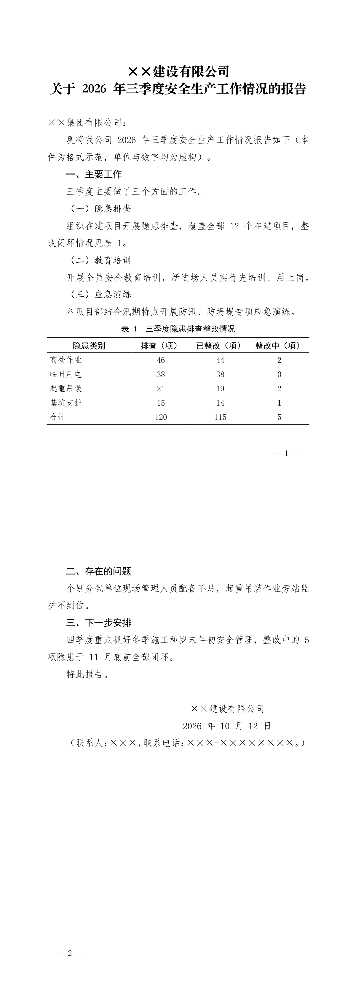

<p align="center"></p>

<p align="center">
  <a href="https://github.com/imhuhe/gongwen-kit/actions/workflows/ci.yml"></a>
  <a href="https://github.com/imhuhe/gongwen-kit/releases"></a>
  
  
  <a href="LICENSE"></a>
</p>

按 GB/T 9704《党政机关公文格式》生成标准 Word 公文，出稿当场机检；现成的稿子也能修，
版式直接改，体例写成 Word 修订痕迹逐条确认，数字只插批注。写稿人只管内容，版式交给国标，数字对不对得上交给机检。

面向党政机关、央国企和一般单位的日常公文：通知、报告、请示、函、纪要、管理办法、条例。


## 快速上手

```bash
git clone https://github.com/imhuhe/gongwen-kit.git && cd gongwen-kit
npm install
npm test          # 生成七份样张，每份跑完三道机检；再跑全部必错标本与必过标本
```

样张在 `samples/word/`，用 Word 打开即可。

## 样张

七份样张由 Word 导出的 PDF 在 [docs/样张/](docs/样张/)，GitHub 上可以直接翻页看。

**要素全览**：一份把全部构件摆出来——联合行文红头、份号密级紧急程度、四层层次序数、三线表、
附件说明、联合落款、附件页、版记。点图看 PDF。

[](docs/样张/公文要素全览.pdf)

**非红头企业文书**：央国企日常最常用的形态，没有版头，从标题直接起，版心与其余要素照样按国标。
表格合计和正文「三个方面」都过了数字机检。

[](docs/样张/企业内部报告.pdf)

| 样张 | 形态 | 页数 |
|---|---|---|
| [公文要素全览](docs/样张/公文要素全览.pdf) | 联合行文、全部构件 | 5 |
| [公文通知](docs/样张/公文通知.pdf) | 下行文，完整版头与版记 | 2 |
| [公文请示](docs/样张/公文请示.pdf) | 上行文，签发人、附件页 | 4 |
| [公文信函](docs/样张/公文信函.pdf) | 信函格式（10.1） | 2 |
| [公文纪要](docs/样张/公文纪要.pdf) | 纪要格式（10.3） | 2 |
| [公文管理办法](docs/样张/公文管理办法.pdf) | 条文体，章条连号 | 3 |
| [企业内部报告](docs/样张/企业内部报告.pdf) | 非红头 | 2 |

出图的机器没装方正小标宋，样张 PDF 的标题和机关标志用 Songti SC Black 代替；装了字体后
重新生成，就是国标用字。

> 0.4.1 起，单一机关加盖印章的落款按 GB/T 9704 7.3.5.1「以成文日期为准居中」生成。
> 0.4.2 起，标题/章标题的 `rFonts` 补齐 `w:hAnsi`（引号、× 不再回退仿宋）；落款估宽把
> ×、· 按全角算；出稿 `styles.xml` 去重；自家出稿跑 `fix` 时把版式修复结果与输入做语义比对（样式、正文直接格式、节属性、页脚、settings 开关）：完全相同才报「版式（未改）」，任一处改乱都照常重排（`--layout` 可强制）。
> `docs/样张/` 的通知、请示、信函、企业内部报告四份 PDF 已按 0.4.2 重新导出，落款页的
> 署名中心与日期中心偏差小于 1pt。
>
> 0.4.3 起，`fix` 的「版式（直接改）」只列语义上真正变化的项，不再固定列五项；
> 0.4.4 起报告措辞按文体取（条文体的 Heading1 写「章标题」加实际字体与居中，不写「一级黑体」），
> 正文差异分开写字体字号、手设行距与补的「首行不缩进」；
> 版本变更见 [CHANGELOG.md](CHANGELOG.md)，发布步骤见 [docs/发布.md](docs/发布.md)。

## 它查什么

每份稿子写盘后自动跑三道机检，**哪一道不过就非零退出**，不算出稿。

| 机检 | 查什么 | 例子 |
|---|---|---|
| 体例 | GB/T 9704 版心、层次序数、日期与发文字号写法、全半角；styles.xml 重复 styleId | `发文字号：年份用六角括号〔〕：【2026】` |
| 数字自洽 | 表格合计与分项、百分比构成、跨表同一指标；正文「以下三点」与实际列出的条数；正文同一指标多处取值、正文与表格取值（这两项只提示） | `计数与列举：「以下三项」其后列了 2 个下一级标题` |
| 文风 | 异形词、中文里的半角标点（规范层，命中即拦）；套话、黑话、空词（风格层，只提示） | `异形词 1 处（GF 1001-2001）：筹画 → 筹划` |

体例机检的每条规则都有「必错的标本」做负对照；文风规范层与数字自洽同样有负对照，规则报不出来，测试就失败。
靠标签匹配、可能误报的规则（我司、GDP、斜体等）只提示不拦稿，另有「必过的标本」防误报。
`check --json` 的汇总带工具版本、生成时间与文档 sha256，可以存成文件，作为合规凭据留档。

现成的 .docx 也能直接修，见下文「修复现成文件」。

## 和别家比

按国标排版、查错别字，大厂和开源都在做，有的版式比本仓全。本仓多做的是数字自洽这一类跨段落检查。
各家能力取自官网与公开资料（2026-10-13 核对，厂商口径），来源列在图底。


## 能力

- **两种体式**：行文体（报告、请示、函、纪要等）与条文体（管理办法、条例，章条全文连号）
- **版头**：发文机关标志（单个与联合行文）、发文字号、签发人（上行文，回行对齐）、
  红色分隔线；数字红头与预印套打两种形态；份号、密级、紧急程度可选
- **信函格式**（GB/T 9704 10.1）：标志距上页边 30 mm、两条 170 mm 红色双线、
  发文字号居右、首页不印页码、版记只留抄送
- **纪要格式**（GB/T 9704 10.3）：「×××纪要」标志、期号；出席、请假、列席名单
  标签黑体、名单仿宋，回行与冒号后首字对齐
- **版记**：抄送机关、印发机关和印发日期、三条分隔线，浮动锚定在版心底部
- **附件页**：另面编排、单附件不编号、不装订附件的发文字号

关键尺寸都在 Word 渲染后量过，例如版头标志上缘距版心 35.05 mm（标准 35），
信函双线长 170.01 mm（标准 170）。量测脚本和全部校准值见 [docs/版式.md](docs/版式.md)。

## 数据在哪里处理

gongwen-kit 本身全部在本机运行，安装后不联网：排版和机检都不调用任何服务。
已经写好的稿子交给它排版、检查，内容不出本机。

让 AI 起草正文时，内容去哪由你用的模型决定。用云端模型，起草的内容会发给模型服务商；
涉密材料要么自己写好只交给它排版检查，要么接内网或本地部署的模型。

### 内网和离线安装

目标机器联不了网时，在能上网的机器上打一个带依赖的包：

```bash
node tools/pack-offline.js --out ~/Desktop      # 产出 gongwen-kit-v<版本>-offline.tgz，约 2 MB
```

包里是 git 已跟踪的文件加生产依赖（docx、jszip、sax，都是纯 JavaScript），不含宣传图、PDF 样张、测试和 `AGENTS.md`，
另附一份《离线包说明.md》写明缺什么，所以包里 README 指向图片和样张的链接打不开，`npm test` 也不可用。
有未提交的改动或未跟踪的新文件时，打包会拒绝并点名这些文件，免得新文件被静默漏掉。
拷到内网机器解压，机器上只需要 Node 18 以上，不跑 npm、不联网：

```bash
tar -xzf gongwen-kit-v*-offline.tgz
node gongwen-kit-v*/bin/gongwen.js where        # 能打印目录就说明可用
```

之后按下文「当作 agent skill 用」把解压目录链进 skill 目录。已在本机解压后完整走通起稿、出稿、机检；打包脚本的文件选择与拒绝逻辑由 `npm test` 覆盖（不联网），
`npm ci` 那一步没有测试。Windows 内网机上的解压与运行没有实测。

两处要提前备好：可选的 PDF 检查需要 PyMuPDF，离线机器上要预先下载 wheel；
标题和机关标志用的方正小标宋要由目标机器自己提供，没装时的替代见 [docs/字体.md](docs/字体.md)。

## 当作 agent skill 用

目录里的 `SKILL.md` 是入口，格式是 Agent Skills 通用的 `name` 加 `description`。
各家读取的目录不同，装法如下：

| 工具 | 用户级目录 | 项目级目录 | 依据 |
|---|---|---|---|
| Claude Code | `~/.claude/skills/` | `.claude/skills/` | code.claude.com/docs/en/skills |
| Codex | `~/.agents/skills/` | `.agents/skills/` | developers.openai.com/codex/skills |
| DeepSeek Harness（`dsh`） | `~/.agents/skills/` 或 `~/.dsh/skills/` | `.agents/skills/` 或 `.dsh/skills/` | 其仓库 `packages/skill/skill-filesystem` 的说明 |
| OpenCode | `~/.agents/skills/`、`~/.claude/skills/` 或 `~/.config/opencode/skills/` | `.agents/skills/`、`.claude/skills/` 或 `.opencode/skills/` | opencode.ai/docs/skills |

Codex、DeepSeek Harness 和 OpenCode 都读 `~/.agents/skills/`，装一处三边都能读到：

```bash
mkdir -p ~/.agents/skills
ln -s "$(pwd)" ~/.agents/skills/gongwen-kit
```

Claude Code 换成 `~/.claude/skills/gongwen-kit`。

之后直接说「按公文格式起草一份关于××的通知」即可。

**与通用 Office skill 并存。** 是否自带通用 Office/Word skill 取决于安装的 bundle 与 profile：
本机 DeepSeek Harness 0.2.0-rc.2 的 web profile 没有挂载 `office`，Claude Code 侧则可能使用自带的 Word 能力。
本 skill 的 `description` 写明了只管中文公文、不管合同简历等一般 Word 文档，`SKILL.md` 也要求中文公文一律走本 skill。
两者可以同时装；但模型是否总能选对尚未盲测，中文公文请在 `CLAUDE.md` 或提示词里显式锁定本 skill，
不要用通用 skill 重做版式。

**与 agent 的工作目录无关。** agent 的工作目录是你的项目，不是本仓库，所以命令统一走入口脚本，
任何目录都能调：

```bash
node /path/to/gongwen-kit/bin/gongwen.js new --form wen --out 稿子.js   # 起稿源脚本
node /path/to/gongwen-kit/bin/gongwen.js check 稿子.docx --strict       # 三道机检依次跑完
node /path/to/gongwen-kit/bin/gongwen.js check 稿子.docx --json         # 同上，stdout 只出一份 JSON（出错也是），退出码 0 通过、1 命中、2 工具故障
node /path/to/gongwen-kit/bin/gongwen.js fix 稿子.docx --dry-run        # 修复预演：只报告，不写文件
node /path/to/gongwen-kit/bin/gongwen.js fix 稿子.docx                  # 修复现成文件（输出副本，原文件不动）
```

`SKILL.md` 里把这个目录记作 `$KIT`，它只是记号，不是环境变量：agent 要换成加载 skill 时看到的 `SKILL.md` 所在目录的绝对路径。
`npm link` 之后可以直接敲 `gongwen`。

**验证状态。** 目录约定取自上表四家的官方文档与源码说明（2026-10-17 核对）；入口脚本在仓库之外的目录里走完起稿、
出稿、机检、修复，`npm test` 覆盖这一点，`SKILL.md` 的 frontmatter 也按 DeepSeek Harness
与 Codex 的规则在测试里近似校验（自写的简易解析，不是它们的真实加载器）。
2026-10-23 实测：DeepSeek Harness 0.2.0-rc.2（web profile）能加载本 skill，并走完起稿、出稿、三道机检；
本机 Claude Code 2.1.308 已确认用户级 skill 路径（`~/.claude/skills/gongwen-kit`）指向本仓，
Claude Code 内的端到端由该会话做验收。Codex 上的真实加载与端到端起草仍未实测。
DeepSeek Harness 仍是 developer preview，目录约定可能变。

## 写自己的公文

```bash
node tools/new-doc.js --form wen --out 我的稿子.js   # 行文体；条文体用 --form zhang
node 我的稿子.js                                     # 出稿，写盘后自动机检
```

所有构件的用法看 `templates/complete.js`，真实场景看 `templates/notice.js`、`templates/xinhan.js` 与 `templates/jiyao.js`；
不要红头的企业文书看 `templates/qiye.js`。

## 修复现成文件

手写的、别人发来的、旧模板出的 .docx，交给它修一遍：

```bash
node tools/fix-doc.js 某文件.docx --dry-run   # 先预演：只报告，不写文件
node tools/fix-doc.js 某文件.docx             # 输出 某文件-修订.docx，原文件不动
```

分三档处理：

| 档 | 怎么改 | 例子 |
|---|---|---|
| 版式 | 直接改 | 版心与网格、正文与层次标题字体、公文标题、页码；表题/附件页/版记/纪要名单/份号密级/红头/表格/文本框不交还样式 |
| 体例与规范层文风 | 写成 Word 修订，在「审阅」里逐条接受或拒绝 | `【2026】第012号 → 〔2026〕12号`、`05月08日 → 5月8日`、`筹画 → 筹划` |
| 数字与要靠判断的项 | 不改，插批注 | 合计与分项对不上、「以下三点」只列了两点 |

数字一律不自动改：合计错还是分项错，工具判断不了。引号与书名号里的原话、网址、超链接、
表格里的数字、红头与版头、表题、附件页、版记、纪要名单、份号密级都不动；全部拒绝修订，正文逐字等于原文。
信函/纪要格式会自动跳过通用版式（`--layout` 可强制）；条文体按章小标宋、条仿宋处理。
默认对要交付的稿子先跑 `--dry-run`，确认报告后再写文件。规则、不改什么、已知限制见
[docs/修复.md](docs/修复.md)。

只体检不改：

```bash
node checks/check-doc.js   某文件.docx --strict    # 体例
node checks/check-num.js   某文件.docx --strict    # 数字自洽
node checks/check-style.js 某文件.docx --strict    # 文风
```

导出 PDF 后核字体与版面（可选，需要 `pip install pymupdf`）：

```bash
python3 tools/check-pdf.py 导出件.pdf
```

## 依据

GB/T 9704—2012、GB/T 15834、GB/T 15835、GB/T 1.1、GB/T 8170、GF 1001，
以及《党政机关公文处理工作条例》（中办发〔2012〕14 号）。党政机关适用，其他机关和单位
参照执行。条款对照见 [docs/依据.md](docs/依据.md)。

标题与发文机关标志默认用方正小标宋简体，需要自行安装；没装时的替代方案见
[docs/字体.md](docs/字体.md)。版式在 Mac 版微软 Word 上渲染验收；Windows 版 Word 与 WPS 没有逐项验过渲染。
测试在 Windows、macOS、Linux 与 Node 18／20／22 上都跑过（CI）。

## 文档

| 文件 | 内容 |
|---|---|
| [docs/依据.md](docs/依据.md) | 引用的国标与条款对照 |
| [docs/版式.md](docs/版式.md) | 硬指标、校准值、踩过的坑，改版式前必读 |
| [docs/修复.md](docs/修复.md) | 修复现成文件：三档处理、规则表、不改什么、已知限制 |
| [docs/文风.md](docs/文风.md) | 两层判据、词表校准办法、怎么加自己的词 |
| [docs/字体.md](docs/字体.md) | 国标用字对照、方正小标宋授权与替代、字体验证 |
| [SKILL.md](SKILL.md) | 给 agent 的入口（工作流与要素速查） |

## 不做的事

不校对内容与政治表述，判断和责任归写稿人；工具只管形制合规与数字自洽。
不做命令（令）格式、OFD 与电子公文交换、印章图像与数字签章（只预留位置）、公文流转审批、云端服务。

## 维护

个人开源项目，低频维护。issue 会看，不承诺处理时限。许可证 MIT。
